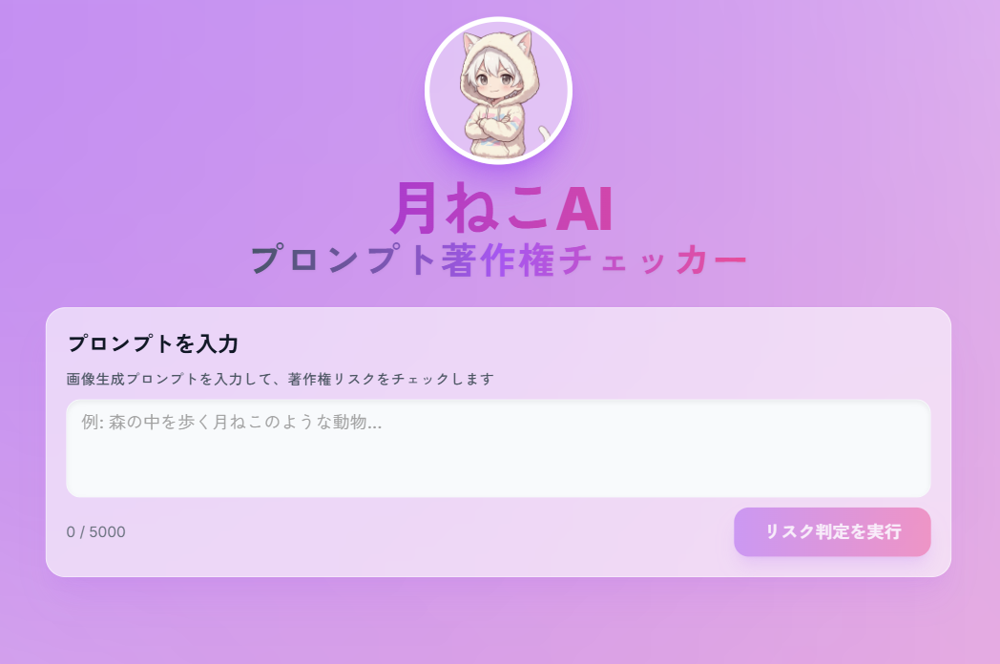

# 🐱 月ねこAI - プロンプト著作権チェッカー

<p align="center">
  
</p>

<p align="center">
  <strong>AI画像生成のプロンプトを安心・安全に！</strong><br>
  著作権リスクをAIがチェックして、安全な代替プロンプトを提案します
</p>

<p align="center">
  
  
  
  
  
</p>

---

## 📸 スクリーンショット

<p align="center">
  
</p>

---

## ✨ こんな悩みを解決します

- 🤔 「このキャラクター名、使っていいのかな...？」
- 😰 「著作権侵害になったらどうしよう」
- 🎨 「○○風って書いたけど、大丈夫？」

**月ねこAI**が、あなたのプロンプトをチェックして、安全に画像生成を楽しめるようサポートします！

---

## 🚀 特徴

| 機能 | 説明 |
|------|------|
| 🔍 **リアルタイム判定** | AIがプロンプトを即座に分析し、著作権リスクを検出 |
| 📊 **リスクスコア表示** | High / Medium / Low の3段階で分かりやすく表示 |
| ✏️ **安全な代替案を提案** | リスクのある表現を、安全な表現に自動変換 |
| 📋 **ワンクリックコピー** | 安全なプロンプトをすぐにコピーして使える |
| 🇯🇵 **日本語対応** | 自然な日本語でプロンプトを再構成 |

---

## 🏗️ アーキテクチャ

```
┌─────────────┐     ┌─────────────┐     ┌─────────────────┐
│   ユーザー   │────▶│  React App  │────▶│  LLM API        │
│  (ブラウザ)  │◀────│  (Vite)     │◀────│  Gemini/OpenAI  │
└─────────────┘     └─────────────┘     └─────────────────┘
                           │
                    ┌──────┴──────┐
                    │  判定ロジック │
                    │  (logic.ts)  │
                    └─────────────┘
```

1. ユーザーがプロンプトを入力
2. React アプリが LLM API に分析リクエストを送信
3. LLM がプロンプトを分析し、著作権リスクを判定
4. 結果をユーザーに表示（リスクスコア + 安全な代替案）

---

## 📖 使い方

1. **プロンプトを入力** - チェックしたいプロンプトを入力欄に貼り付け
2. **判定ボタンをクリック** - AIがリスクを分析
3. **結果を確認** - リスクスコアと検出された問題を確認
4. **安全なプロンプトをコピー** - 提案された安全なプロンプトを使用

---

## 🛠️ セットアップ

### 必要なもの

- Node.js 18以上
- npm または yarn
- Google Gemini API キー または OpenAI API キー

### クイックスタート

```bash
# 1. リポジトリをクローン
git clone https://github.com/nekoai-lab/ai-prompt-copyright-checker.git
cd ai-prompt-copyright-checker

# 2. 依存関係をインストール
npm install

# 3. 環境変数を設定
cp .env.example .env
# .envファイルを編集してAPIキーを設定

# 4. 開発サーバーを起動
npm run dev
```

### 環境変数の設定

`.env.example` をコピーして `.env` ファイルを作成し、APIキーを設定してください：

```env
# 使用するLLMプロバイダー（gemini または openai）
VITE_LLM_PROVIDER=gemini

# Google Gemini API Key（推奨）
VITE_GEMINI_API_KEY=your_api_key_here

# または OpenAI API Key
VITE_OPENAI_API_KEY=your_api_key_here
```

<details>
<summary>📌 APIキーの取得方法</summary>

### Google Gemini API（推奨・無料枠あり）

1. [Google AI Studio](https://makersuite.google.com/app/apikey) にアクセス
2. Googleアカウントでログイン
3. 「Create API Key」をクリック
4. 生成されたキーを`.env`ファイルに設定

### OpenAI API

1. [OpenAI Platform](https://platform.openai.com/api-keys) にアクセス
2. アカウントを作成またはログイン
3. 「Create new secret key」をクリック
4. 生成されたキーを`.env`ファイルに設定

</details>

---

## 🔧 開発者向け情報

### 技術スタック

| カテゴリ | 技術 |
|---------|------|
| フレームワーク | React 18 |
| ビルドツール | Vite 5 |
| 言語 | TypeScript 5.2 |
| スタイリング | Tailwind CSS 3 |
| UIコンポーネント | Shadcn UI / Radix UI |
| アイコン | Lucide React |
| AI API | Google Gemini / OpenAI |

### コマンド

```bash
npm run dev      # 開発サーバー起動（http://localhost:5173）
npm run build    # 本番ビルド
npm run preview  # ビルドプレビュー
npm run lint     # ESLint実行
```

### プロジェクト構造

```
src/
├── App.tsx            # メインアプリ
├── logic.ts           # API呼び出し・判定ロジック
├── types.ts           # 型定義
├── index.css          # グローバルスタイル
├── main.tsx           # エントリーポイント
├── components/
│   ├── ResultView.tsx # 結果表示コンポーネント
│   └── ui/            # Shadcn UIコンポーネント
│       ├── alert.tsx
│       ├── badge.tsx
│       ├── button.tsx
│       ├── card.tsx
│       └── textarea.tsx
└── lib/
    └── utils.ts       # ユーティリティ関数
```

### テスト

詳細なテスト手順は [TESTING.md](./TESTING.md) を参照してください。

---

## 📝 注意事項

- このツールは著作権リスクの判定を**支援**するものであり、法的なアドバイスではありません
- 最終的な判断はご自身の責任で行ってください
- APIの使用には料金が発生する場合があります（Gemini APIは無料枠あり）
- LLMの判定は100%正確ではありません。参考情報としてご利用ください

---

## 🤝 コントリビューション

プルリクエストは歓迎です！大きな変更を加える場合は、まずIssueを作成して変更内容を議論してください。

1. Fork する
2. Feature ブランチを作成 (`git checkout -b feature/amazing-feature`)
3. 変更をコミット (`git commit -m 'Add amazing feature'`)
4. ブランチにプッシュ (`git push origin feature/amazing-feature`)
5. Pull Request を作成

---

## 📄 ライセンス

MIT License - 詳細は [LICENSE](./LICENSE) を参照してください。

---

<p align="center">
  Made with 💜 by <a href="https://github.com/nekoai-lab">nekoai-lab</a>
</p>
